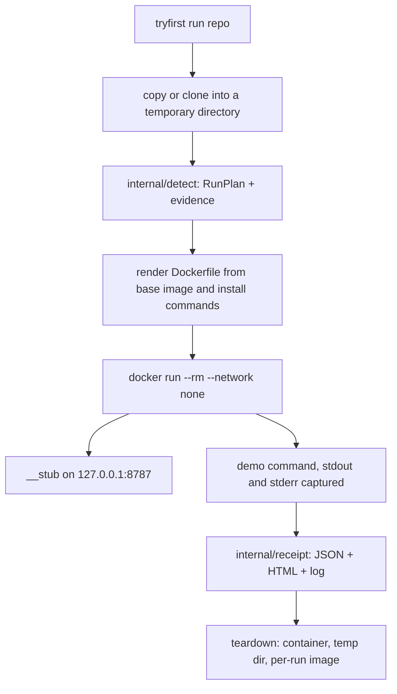

**English** | [简体中文](README.md)

# Tryfirst

<p align="center">
  
</p>

<p align="center">
  
  
  
  
  
  
</p>

**Tryfirst runs a repository's own demo in a throwaway sandbox.** One command, `tryfirst run <repo>`: no sign-up, no API Key of your own, and everything is destroyed on exit. No container, no temp directory, no per-run image survives — only one reviewable run receipt.

It answers one small question: **does this repository actually run, and what does its output look like?** It does not score a repository, does not perform static risk checks, and does not judge the quality of a model's answer.

## Quickstart

Go 1.24+ is required to install from source. `run` needs a running Docker daemon on your machine; `plan` does not.

```bash
go install github.com/SuperMarioYL/tryfirst@v0.1.0

# 1. See how it intends to run the repo (no Docker needed)
tryfirst plan https://github.com/<owner>/<skill-repo>

# 2. Actually try it (Docker required)
tryfirst run https://github.com/<owner>/<skill-repo>
```

`<repo>` is either a git URL or a local directory. After `run`, read three lines:

- `verdict:` — `runs`, `fails`, or `no_runnable_demo`
- `receipt:` — `./tryfirst-report/<owner>-<repo>-<sha8>.json`
- `report:` — the same stem as a single-file `.html` that opens offline

`no_runnable_demo` is a normal result, not an error: the README has no executable quickstart, or `SKILL.md` is only a prompt. Detection explains why and still writes a receipt. Without Docker, `run` stops before creating a container and leaves nothing half-finished.

## Demo

<p>
  <a href="docs/demo.cast"></a>
  <b><a href="docs/demo.cast">Play the 30-second terminal demo (docs/demo.cast)</a></b> · locally: <code>asciinema play docs/demo.cast</code>
</p>

The recording uses a local sample repository, `./hello-skill`, whose `package.json` declares a `start` script. This `plan` output is real:

```text
$ tryfirst plan ./hello-skill
repo:     ./hello-skill
commit:   744b7cce
runtime:  node-22
image:    node:22-slim
install:  npm install
demo:     npm run start
evidence: package.json:scripts.start
verdict:  plan_only
```

The same plan is available as JSON for scripts:

```json
{
  "repo": "./hello-skill",
  "commit": "744b7cce",
  "runtime": "node-22",
  "base_image": "node:22-slim",
  "install": [
    "npm install"
  ],
  "demo_command": [
    "npm",
    "run",
    "start"
  ],
  "evidence": "package.json:scripts.start"
}
```

A repository with only a `SKILL.md` and no executable demo gets an explicit answer too:

```text
repo:     ./prompt-only-skill
commit:   nogit
runtime:
image:
verdict:  no_runnable_demo
reason:   no package.json, pyproject.toml, requirements.txt or README quickstart found; SKILL.md ("prompt-only-skill") declares no executable demo
```

**What this demo does and does not cover:** the recording machine had no running Docker daemon (`docker info` failed), so no real `tryfirst run` was captured. `docs/demo.cast` contains the real `plan` output, the real Docker-unavailable error, and receipt fields explicitly labeled as a contract excerpt — not a completed sandbox run. On a machine with Docker, `run` prints the `verdict`, `receipt`, and `report` paths; these facts are recorded in [`docs/demo-results.json`](docs/demo-results.json).

## Why 

There are four usual ways to find out whether an unfamiliar repository runs, and each leaves a gap:

| Approach | What it needs | What it answers |
| --- | --- | --- |
| Manual clone, install, key | On the order of 20-40 minutes of setup, 3-6 dependencies, a working API Key | It runs, but leaves dependencies and residue, and hands your key to code you have not read |
| `docker run` | A Dockerfile or equivalent runnable declaration in the repo | It runs; but many skill repos are a prompt plus a script with nothing to build |
| Hosted cloud dev environment | An account, a repository you own, a build config | It runs; trying something for 90 seconds costs identity and configuration |
| Static scanning | Does not execute code | What the code *might* do; never what the output looks like |
| **Tryfirst** | One command and local Docker | Whether it runs, what the output is, where the command came from, plus a reviewable receipt |

The gap this tries to close is **20-40 minutes of cloning, installing, and key handling versus a sandbox try-run with no account and no key of your own.** 20-40 minutes is a typical order of magnitude for the manual path, and 90 seconds is the design target; neither is a benchmark result, and actual time depends on whether the base image is cached and how heavy the dependency install is.

**How a demo runs without a key.** The sandbox starts a deterministic model stub on `127.0.0.1:8787` inside the container, serving an OpenAI-compatible `/v1/chat/completions` and an Anthropic-compatible `/v1/messages`. It fills `OPENAI_BASE_URL`, `OPENAI_API_KEY`, `ANTHROPIC_BASE_URL`, `ANTHROPIC_API_KEY` and related variables with stub values. The container runs under `--network none`, so there is no egress. A demo can authenticate, build a request, parse a reply, and render a UI using `tryfirst-stub` as the key, not yours.

That fixes what a stub-mode receipt can claim: `model_mode` is recorded as `stub`. It proves **wiring and output shape**, not answer quality. When real inference is required, `--model live` routes through a host-side gate: the credential stays in the operator's process, the container gets only an ephemeral run token, and the run is cut at 20 requests, 50k tokens, or 90 seconds.

**Every command is attributable.** Install and demo commands in a plan are not guesses; each carries its source:

- `package.json:scripts.start`
- `pyproject.toml:[project.scripts].tryfirst`
- `README:## Quick Start > bash fence @L66`

The README fallback is a positive-evidence rule. The heading must qualify (quick start, getting started, setup, install, usage, and their Chinese equivalents); the fence must be a shell language; the first token at line start must be an executable program; and blocks with `<...>`, `YOUR_...`, `${...}` placeholders or CUDA / system-package prerequisites do not count. A heading with a code block that only shows library usage yields `no_runnable_demo` with the reason. Commands without a source are not executed and do not appear in the receipt.

## Capabilities 

### Detect and plan (m1)

- Derives runtime, base image, install commands, and demo command from `package.json`, `pyproject.toml`, `requirements.txt`, or a README quickstart section.
- Every command carries provenance; `tryfirst plan <repo> --json --out plan.json` produces a plan that can feed a pipeline.
- `SKILL.md` parsing is tolerant: missing frontmatter and unknown keys (`metadata`, `allowed-tools`, `version`, and so on) are not parse errors.
- With nothing executable, it returns `no_runnable_demo` and a concrete reason, still with exit code 0.

### Throwaway sandbox (m2)

- Renders a Dockerfile from the detected plan, builds a per-run image on a cached base, and runs the container with `--rm`.
- An architecture-matched stub binary is mounted into the container and started before the demo; the demo's stdout and stderr are captured verbatim.
- A timeout (180 seconds by default) kills the demo and is recorded in the receipt; `--network none` makes a demo that needs egress fail fast.
- On exit, the container, the per-run image, and the temporary checkout are removed; `docker ps -a` and the temp directory should hold nothing from the run.
- Limits: a running Docker daemon is required; native Windows and rootless-Podman-only setups are outside v0.1.

### Receipt and report (m3)

- Every run writes a `tryfirst/receipt@1` JSON: plan and provenance, verdict, exit code, duration, network mode, model-call counts, truncated logs, and artifact sha256 values.
- The receipt is sealed with a sha256 over canonical JSON (the `digest` field itself is excluded), so it can be recomputed offline.
- The matching `.html` report references no external assets and opens without a network; the matching `.log` stores the combined output.
- In stub mode, two runs of one commit share the `plan` block but differ in `run_id`, `started_at`, duration, and digest.
- `--keep` preserves the cloned work directory for inspection; the default removes it.

### Live gate and cleanup (m4)

- `--model live` requires both `TRYFIRST_UPSTREAM_BASE_URL` and `TRYFIRST_UPSTREAM_API_KEY`; if either is missing it fails before touching the repository, let alone starting a container.
- The container sees only a per-run ephemeral token, never the upstream credential.
- Hitting any cap — 20 requests, 50k tokens, or 90 seconds — returns 429 and records `cap_hit` in the receipt.
- `tryfirst gc` removes images labeled `tryfirst.managed` that are older than seven days; shared base images are untouched.

## Architecture

One Go binary, one `docker` child process, one container. No server, no database.



The plan translates "what the repository says about itself" into "what can be executed":

```go
type RunPlan struct {
    Repo, Commit, Runtime, BaseImage string
    Install, DemoCommand             []string
    Evidence     string            // e.g. "README:## Quick Start > bash fence @L66"
    ModelEnv     map[string]string // stub or gate values
    NoDemoReason string
}
```

The receipt records what happened after the plan: `verdict`, `exit_code`, `duration_ms`, `network`, `stdout`, `stderr`, `artifacts`, `model_calls`, and `digest`. The plan can be derived; these values can only be obtained by running — which is the line between Tryfirst and a static scanner.

## Configuration 

| Option / environment variable | Default | Effect |
| --- | --- | --- |
| `--json` (plan) | off | Print the plan JSON and write `plan.json` |
| `--out <path>` (plan) | `plan.json` | Destination for `--json` |
| `--model stub\|live` (run) | `stub` | `stub` is offline and credential-free; `live` goes through the host gate |
| `--timeout <duration>` (run) | `180s` | Demo timeout; the process is killed and the receipt records it |
| `--report-dir <path>` (run) | `tryfirst-report` | Directory for the receipt, HTML report, and log |
| `--keep` (run) | off | Keep the cloned work directory; the default removes it |
| `TRYFIRST_UPSTREAM_BASE_URL` | unset | Upstream URL for `--model live` (OpenAI-compatible) |
| `TRYFIRST_UPSTREAM_API_KEY` | unset | Upstream credential; it only exists in the host-side gate process |

Notes:

- `run` writes `<report-dir>/<owner>-<repo>-<sha8>.{json,html,log}`.
- `plan` does not accept `--report-dir` and does not write a receipt; it only prints or saves the plan.
- Offline or cross-compiled environments can point `TRYFIRST_STUB_BIN` at a prebuilt Linux stub or `TRYFIRST_STUB_SRC` at a source directory, so no Go toolchain is invoked at run time.
- `tryfirst gc` takes no extra arguments; it only prunes Tryfirst-labeled images.

## Pricing 

The open CLI is free under MIT. There are no accounts, no hosted service, and no telemetry; the CLI and the sandbox run on your own machine.

A team license is an annual self-hosted license for platform-engineering and developer-productivity teams that need to keep the evidence inside the company:

| Plan | Price | For |
| --- | --- | --- |
| Team | ¥9,800 / year | Up to 10 engineers |
| Organization | ¥29,800 / year | Unlimited engineers, one day of gate deployment, and 4 hours of support |

The license covers receipt retention and archival conventions for private repositories, wiring `--model live` to **your own** upstream (the credential never leaves your host), and a procurement-appendix template. Seats are contractual; there is no account system and no per-run billing — a run has no metered invoice.

The smallest validation path is a 60-minute screen share: pick three repositories from your shortlist, run them live, and paste the receipts into your own review template for the security team. Bank transfer and VAT invoices are supported.

What is deliberately not sold: a hosted sandbox, a "try" button, or a per-token model proxy.

## Roadmap 

**v0.1.0 (current)** — the four milestones above: detect and plan, throwaway sandbox, receipt and report, live gate and gc.

**Explicitly not in v0.1:**

- A hosted "try" button, web UI, or shareable public links (CLI plus a local HTML report only)
- Executing prompt-only skills against a model (v0.1 reports them as `no_runnable_demo`)
- Accounts, quotas, billing, or a multi-tenant public sandbox
- Adapters beyond `package.json`, `pyproject.toml`, `requirements.txt`, and README quickstarts
- Native Windows and rootless-Podman-only setups
- Batch mode, watch mode, sandbox reuse, or authoring a demo for a repository
- Static risk scoring, SBOM generation, vulnerability scanning (a different category)
- Isolation backends other than Docker (sandbox-exec, bwrap, and so on)
- Telemetry of any kind

**Later:** v0.2 scope is decided by real run data — the share of `no_runnable_demo` in the first 50 runs and the most common failure reasons. If most target repositories ship no runnable demo, that is a fact worth seeing, not a bug that more features can fix.

## License

MIT © 2026 SuperMarioYL · [LICENSE](LICENSE)
