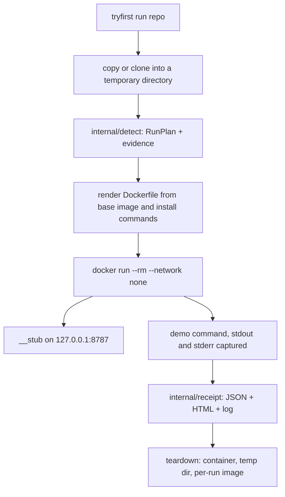

[English](README.en.md) | **简体中文**

# Tryfirst

<p align="center">
  
</p>

<p align="center">
  
  
  
  
  
  
</p>

**Tryfirst 把 GitHub 上 Agentic Skill 仓库自带的 demo 跑进一次性沙箱。** 一条命令 `tryfirst run <repo>`：不注册、不填自己的 API Key、退出即自毁。容器、临时目录和每-run 镜像都不留，只留下一份可复核的运行凭据。

它只回答一个小问题：**这个仓库跑不跑得起来，输出长什么样。** 不给仓库打分，不做静态风险体检，也不判断模型回答得好不好。

## 快速开始

需要 Go 1.24+ 才能从源码安装；`run` 需要本机有运行中的 Docker daemon，`plan` 不需要。

```bash
go install github.com/SuperMarioYL/tryfirst@v0.1.0

# 1. 先看它准备怎么跑（不需要 Docker）
tryfirst plan https://github.com/<owner>/<skill-repo>

# 2. 真正试跑（需要 Docker）
tryfirst run https://github.com/<owner>/<skill-repo>
```

`<repo>` 可以是 git URL，也可以是本地目录。`run` 结束后看三行：

- `verdict:` — `runs`、`fails`，或者 `no_runnable_demo`
- `receipt:` — `./tryfirst-report/<owner>-<repo>-<sha8>.json`
- `report:` — 同目录下同名 `.html`，单文件、离线可打开

`no_runnable_demo` 是一个正常结果，不是错误：仓库的 README 里没有可执行的快速开始，`SKILL.md` 也只是提示词，检测会说明原因并照样写一份凭据。没有 Docker 时 `run` 会在创建容器之前停下，不会留下半成品。

## 演示

<p>
  <a href="docs/demo.cast"></a>
  <b><a href="docs/demo.cast">播放 30 秒终端演示（docs/demo.cast）</a></b> · 本地用 <code>asciinema play docs/demo.cast</code>
</p>

演示录制的是一个本地示例仓库 `./hello-skill`，它的 `package.json` 声明了 `start` 脚本。以下 `plan` 输出是真实执行结果：

```text
$ tryfirst plan ./hello-skill
repo:     ./hello-skill
commit:   744b7cce
runtime:  node-22
image:    node:22-slim
install:  npm install
demo:     npm run start
evidence: package.json:scripts.start
verdict:  plan_only
```

同一份计划可以用 `--json` 交给脚本：

```json
{
  "repo": "./hello-skill",
  "commit": "744b7cce",
  "runtime": "node-22",
  "base_image": "node:22-slim",
  "install": [
    "npm install"
  ],
  "demo_command": [
    "npm",
    "run",
    "start"
  ],
  "evidence": "package.json:scripts.start"
}
```

一个只有 `SKILL.md`、没有可执行 demo 的仓库，检测同样给出明确结论：

```text
repo:     ./prompt-only-skill
commit:   nogit
runtime:
image:
verdict:  no_runnable_demo
reason:   no package.json, pyproject.toml, requirements.txt or README quickstart found; SKILL.md ("prompt-only-skill") declares no executable demo
```

**关于这段演示的边界：** 录制机器上没有运行中的 Docker daemon（`docker info` 失败），所以没有录到一次真实的 `tryfirst run`。`docs/demo.cast` 里包含真实执行的 `plan` 输出、真实的 Docker 不可用报错，以及标注为「契约摘录」的 receipt 字段，不是一次完成的沙箱运行。装有 Docker 的机器上，`run` 会打印 `verdict`、`receipt` 和 `report` 路径；这些事实记录在 [`docs/demo-results.json`](docs/demo-results.json)。

## 为什么 

要判断一个陌生仓库跑不跑得起来，现在通常有四条路，每条都缺一块：

| 方式 | 需要什么 | 能回答什么 |
| --- | --- | --- |
| 手动 clone、装依赖、填 key | 20-40 分钟量级的准备，3-6 个依赖，一个可用的 API Key | 跑得起来，但会留下依赖和残留，也把自己的密钥交给了一段没读过的代码 |
| `docker run` | 仓库自带 Dockerfile 或等价的可运行声明 | 跑得起来；但很多 skill 仓库只有提示词和脚本，没有可构建的环境 |
| 托管云端开发环境 | 账号、自己拥有的仓库、构建配置 | 跑得起来；为了一次 90 秒的尝试，代价是身份和配置 |
| 静态扫描 | 不执行代码 | 代码「可能」做什么；永远回答不了输出长什么样 |
| **Tryfirst** | 一条命令，本机 Docker | 跑不跑得起来、输出是什么、命令从哪来，并留下一份可复核的凭据 |

这里真正想消掉的差距是：**20-40 分钟的 clone、装依赖、配 key，对比一次不需要账号、不需要自己密钥的沙箱试跑。** 20-40 分钟是常见的准备量级，90 秒是设计目标；两者都不是基准测试结果，实际耗时取决于基础镜像是否已缓存、依赖安装有多重。

**没有 key，demo 怎么跑通。** 沙箱在容器内的 `127.0.0.1:8787` 启动一个确定性的模型 stub，同时提供 OpenAI 兼容的 `/v1/chat/completions` 和 Anthropic 兼容的 `/v1/messages`，并把 `OPENAI_BASE_URL`、`OPENAI_API_KEY`、`ANTHROPIC_BASE_URL`、`ANTHROPIC_API_KEY` 等变量填成 stub 值。容器跑在 `--network none` 下，没有任何出网。于是 demo 可以完成认证、拼请求、解析回复、渲染界面，用的却是 `tryfirst-stub` 这个假密钥，不是你的。

这决定了 stub 模式的凭据能声称什么：`model_mode` 记录为 `stub`。它证明的是**接线和输出形状**，不是回答质量。需要真实模型时，`--model live` 走宿主机上的网关，凭据留在操作者进程里，容器只拿到一次性的 run token，并且有 20 请求 / 5 万 token / 90 秒的硬上限。

**每条命令都能追溯。** 计划里的安装和 demo 命令不是猜的，各自带着来源：

- `package.json:scripts.start`
- `pyproject.toml:[project.scripts].tryfirst`
- `README:## Quick Start > bash fence @L66`

README 回退采用正向证据规则：标题必须落在 quick start、getting started、setup、install、usage、快速开始、快速上手这类段落里；代码块必须是 shell 类语言；行首必须是可执行的程序；带 `<...>`、`YOUR_...`、`${...}` 占位符或 CUDA / 系统包安装前置条件的块一律不算。标题下有代码块但只展示库用法，结论就是 `no_runnable_demo`，并写明原因。没有来源的命令不会被执行，也不会出现在凭据里。

## 能力 

### 检测与计划（m1）

- 从 `package.json`、`pyproject.toml`、`requirements.txt` 或 README 快速开始段落推导运行时、基础镜像、安装命令和 demo 命令。
- 每个命令带 provenance；`tryfirst plan <repo> --json --out plan.json` 输出可直接进流水线的计划。
- `SKILL.md` 解析是宽容的：缺少 frontmatter、出现未知键（`metadata`、`allowed-tools`、`version` 等）都不算解析错误。
- 没有可执行 demo 时返回 `no_runnable_demo` 和具体原因，退出码仍为 0。

### 一次性沙箱（m2）

- 按检测结果渲染 Dockerfile，在缓存的基础镜像上构建每-run 镜像，容器用 `--rm` 运行。
- 架构匹配的 stub 二进制挂进容器并先于 demo 启动；demo 的 stdout / stderr 原样捕获。
- 超时（默认 180 秒）会杀掉 demo 并记入凭据；`--network none` 让需要出网的 demo 快速失败。
- 退出时删除容器、每-run 镜像和临时 checkout；`docker ps -a` 和临时目录里不应剩下本次运行的东西。
- 限制：需要运行中的 Docker daemon；原生 Windows 和仅有 rootless Podman 的环境不在 v0.1 支持范围内。

### 凭据与报告（m3）

- 每次运行写 `tryfirst/receipt@1` JSON：计划与来源、verdict、退出码、耗时、网络模式、模型调用计数、截断后的日志、产物 sha256。
- 凭据用规范化 JSON 上的 sha256 封缄（`digest` 字段本身不参与计算），可以离线重算。
- 同名 `.html` 报告不引用任何外部资源，断网也能打开；同名 `.log` 保存合并后的输出。
- stub 模式下，同一 commit 的两次运行共享 `plan` 块，但 `run_id`、`started_at`、耗时和 digest 不同。
- `--keep` 保留本次 clone 的工作目录，便于排查；默认删除。

### 实时网关与清理（m4）

- `--model live` 要求 `TRYFIRST_UPSTREAM_BASE_URL` 和 `TRYFIRST_UPSTREAM_API_KEY` 同时存在；缺一个就在接触仓库之前失败退出，不会启动容器。
- 容器只看到一次性的 per-run token，看不到上游凭据。
- 达到 20 次请求、5 万 token 或 90 秒任一上限时，网关返回 429 并在凭据里记下 `cap_hit`。
- `tryfirst gc` 删除带 `tryfirst.managed` 标签、超过 7 天的镜像，共享基础镜像不受影响。

## 架构

一个 Go 二进制、一个 `docker` 子进程、一个容器；没有服务端，没有数据库。



计划是把「仓库自己怎么说」翻译成「可以执行什么」：

```go
type RunPlan struct {
    Repo, Commit, Runtime, BaseImage string
    Install, DemoCommand             []string
    Evidence     string            // e.g. "README:## Quick Start > bash fence @L66"
    ModelEnv     map[string]string // stub or gate values
    NoDemoReason string
}
```

凭据记录的是计划之后实际发生的事：`verdict`、`exit_code`、`duration_ms`、`network`、`stdout`、`stderr`、`artifacts`、`model_calls` 和 `digest`。计划可以推导，这些值只能跑出来——这也是 Tryfirst 和静态扫描的分界线。

## 配置 

| 选项 / 环境变量 | 默认值 | 作用 |
| --- | --- | --- |
| `--json`（plan） | 关闭 | 输出计划 JSON，并写入 `plan.json` |
| `--out <path>`（plan） | `plan.json` | `--json` 的写入路径 |
| `--model stub\|live`（run） | `stub` | `stub` 不联网、不需要凭据；`live` 走宿主机网关 |
| `--timeout <duration>`（run） | `180s` | demo 的超时时间，超时即杀进程并记入凭据 |
| `--report-dir <path>`（run） | `tryfirst-report` | 凭据、HTML 报告和日志的目录 |
| `--keep`（run） | 关闭 | 保留本次 clone 的工作目录；默认删除 |
| `TRYFIRST_UPSTREAM_BASE_URL` | 无 | `--model live` 的上游地址（OpenAI 兼容） |
| `TRYFIRST_UPSTREAM_API_KEY` | 无 | 上游凭据，只存在于宿主机的网关进程 |

补充：

- `run` 的凭据文件是 `<report-dir>/<owner>-<repo>-<sha8>.{json,html,log}`。
- `plan` 不接受 `--report-dir`，也不写凭据；它只打印或落盘计划。
- 离线或交叉编译环境可以用 `TRYFIRST_STUB_BIN` 指向预编译的 Linux stub，或用 `TRYFIRST_STUB_SRC` 指向源码目录，避免运行时再调用 Go 工具链。
- `tryfirst gc` 不接受额外参数；它只清理带 Tryfirst 标签的镜像。

## 定价 

开源 CLI 免费，MIT 许可。没有账号体系，没有托管服务，也没有任何遥测；CLI 和沙箱都跑在你自己的机器上。

团队授权是给需要「把凭据留在公司里」的研发效能 / 平台工程团队准备的年度自托管许可：

| 方案 | 价格 | 适合 |
| --- | --- | --- |
| 团队版 | ¥9,800 / 年 | ≤ 10 名工程师 |
| 组织版 | ¥29,800 / 年 | 不限人数，含 1 天网关部署与 4 小时支持 |

授权内容：私有仓库的 receipt 留存与归档约定、把 `--model live` 接到**你们自己的**上游（凭据只留在你们的主机）、选型附录模板。席位走合同，不做账号，不做按次计费——一次运行没有可计量的账单。

最小验证路径是一场 60 分钟屏幕共享：从你们 shortlist 里挑三个仓库现场跑，receipt 直接贴进你们的评审模板并转给安全同事。支持对公转账和增值税专用发票。

不卖的东西同样明确：不卖托管沙箱，不卖「试试」按钮，不卖按 token 计费的模型代理。

## 路线图 

**v0.1.0（当前）** — 上述四个里程碑：检测与计划、一次性沙箱、凭据与报告、实时网关与 gc。

**明确不在 v0.1：**

- 托管「试试」按钮、Web UI、可分享的公开链接（只有 CLI 和本地 HTML 报告）
- 把纯提示词 skill 送进模型执行（v0.1 就把它当作 `no_runnable_demo` 报告）
- 账号、配额、计费、多租户公开沙箱
- `package.json`、`pyproject.toml`、`requirements.txt`、README 快速开始之外的仓库适配器
- 原生 Windows、仅有 rootless Podman 的环境
- 批量模式、watch 模式、复用上一次的沙箱、替仓库编写 demo
- 静态风险评分、SBOM、漏洞扫描（这是另一个品类）
- Docker 之外的隔离后端（sandbox-exec、bwrap 等）
- 任何形式的遥测

**之后：** v0.2 的范围由真实运行数据决定——前 50 次运行里 `no_runnable_demo` 占多少、最常见的失败原因是什么。如果大多数目标仓库都不发可运行的 demo，那本身就是需要被看见的事实，不是靠更多功能能修好的 bug。

## 许可证

MIT © 2026 SuperMarioYL · [LICENSE](LICENSE)
